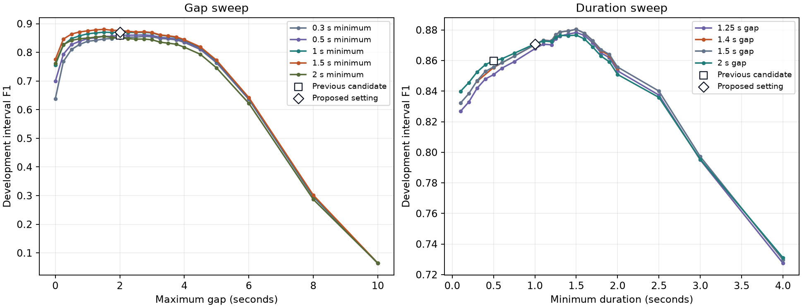

# QFL and diagonal serve-box factorial, with decoder follow-up

This note records the matched five-seed comparison of two proposed InPlay model
changes, the initial decoder retune, and a wider development-only search. The
November 27 holdout confirmed the initial decoder setting. The wider search
excluded that holdout.

## Summary

- Across 5 seeds × 4 held-out-camera folds, neither Gaussian QFL nor the diagonal
  serve-box features produce a statistically resolved interval-F1 gain with the
  production decoder frozen.
- QFL's only resolved effect is undesirable: false starts during reviewed breaks
  rise by 0.37/minute (95% CI +0.04 to +0.70).
- The diagonal serve-box arm is directionally the best model change (+0.011 F1,
  best end MAE and false-start rate, 14/20 fold wins), but its CI includes zero.
- The decoder is the largest resolved lever. A leave-one-camera-out gap sweep
  selects 2.0 s / 0.5 s and gives +0.045 F1 on development and +0.027 F1 on the
  holdout, with false starts roughly halved and about 2.7 frames more absolute
  end error on shared matches.
- The wider search finds a development F1 plateau. Freeze a 2.0 s maximum gap
  and 1.0 s minimum duration for fresh confirmation. Keep the model recipe.

## Model factorial

Design: seven-source development data, four held-out-camera folds, seeds
1729–1733, 25 epochs, batch size 16. Every fold evaluation uses the fixed
production decoder (threshold 0.40, continuation threshold 0.35, maximum gap
0.5 s, minimum duration 0.3 s, edge preservation on). The all-source production
fit is skipped so each arm is compared on identical folds.

| Arm | Feature view | Boundary supervision |
| --- | --- | --- |
| baseline | `full_audio_zscore_motion` | triangle BCE |
| qfl | `full_audio_zscore_motion` | Gaussian quality focal loss |
| diagonal | `serve_boxes_diagonal` | triangle BCE |
| qfl-diagonal | `serve_boxes_diagonal` | Gaussian quality focal loss |

Five-seed means ± SE across seeds:

| Arm | Interval F1 | End MAE (frames) | False starts/min |
| --- | ---: | ---: | ---: |
| baseline | 0.8098 ± 0.0124 | 19.31 ± 0.61 | 0.77 |
| qfl | 0.8189 ± 0.0083 | 18.83 ± 0.53 | 1.15 |
| diagonal | **0.8207 ± 0.0094** | **18.48 ± 0.45** | **0.74** |
| qfl-diagonal | 0.8013 ± 0.0118 | 19.33 ± 0.98 | 0.95 |

Paired fold-seed deltas against baseline (n = 20, 95% CI):

| Arm | ΔF1 | Δ recall | Δ false starts/min | Δ end MAE |
| --- | ---: | ---: | ---: | ---: |
| qfl | +0.0091 [−0.0264, +0.0446] | +0.0244 [−0.0029, +0.0516] | **+0.3715 [+0.0416, +0.7015]** | −0.47 ns |
| diagonal | +0.0109 [−0.0203, +0.0420] | +0.0067 ns | −0.0288 ns | −0.83 ns |
| qfl-diagonal | −0.0085 [−0.0311, +0.0142] | +0.0049 ns | +0.1728 ns | +0.03 ns |

The diagonal arm improves F1 in 4/5 seeds; the pooled effect remains unresolved
(t₄ = 2.37, p ≈ 0.077). QFL's F1 direction is also 4/5 positive but one seed
reverses by −0.035, and its false-start increase is resolved.

## Decoder factorial

An exploratory re-decode of the saved probabilities showed that the 0.5 s production gap
was leaving interval F1 on the table. A preregistered grid varied only the gap
and minimum duration, holding threshold, continuation threshold, and edge
preservation fixed:

- `max_gap_seconds`: 0.75, 1.0, 1.5, 2.0
- `minimum_duration_seconds`: 0.3, 0.5
- control: production 0.5 / 0.3

Selection is leave-one-camera-out within each seed: choose the config on the
other three camera folds, evaluate it on the held-out camera. The deployment
config is the modal choice across the 20 seed × camera cells.

Development, production model arm (20 cells):

| gap / min | Interval F1 | Recall | False starts/min | End MAE |
| --- | ---: | ---: | ---: | ---: |
| 2.0 / 0.5 | **0.860** | 0.845 | **0.33** | 21.3 |
| 1.5 / 0.5 | 0.856 | 0.850 | 0.42 | 20.3 |
| 2.0 / 0.3 | 0.853 | 0.845 | 0.42 | 21.3 |
| 1.0 / 0.5 | 0.848 | 0.849 | 0.47 | 19.7 |
| 1.5 / 0.3 | 0.847 | 0.850 | 0.54 | 20.3 |
| 1.0 / 0.3 | 0.839 | 0.849 | 0.60 | 19.7 |
| 0.75 / 0.5 | 0.839 | 0.844 | 0.49 | 19.1 |
| 0.75 / 0.3 | 0.827 | 0.844 | 0.64 | 19.1 |
| 0.5 / 0.3 (production) | 0.810 | 0.841 | 0.77 | 19.1 |

LOCO-selected decoder: F1 0.854, false starts/min 0.38, end MAE 20.9.

- ΔF1 vs production: +0.0446 [+0.0284, +0.0608]
- Δ false starts/min: −0.3916 [−0.5197, −0.2635]
- Δ end MAE: +1.86 frames [+0.40, +3.31]

Modal choice: 2.0 / 0.5 (11/20), then 1.5 / 0.5 (5/20). The frozen deployment
config is 2.0 s / 0.5 s.

Holdout, one shot with the frozen config (saved production probabilities):

| Metric | Production 0.5 / 0.3 | Frozen 2.0 / 0.5 |
| --- | ---: | ---: |
| Pooled interval F1 | 0.855 | **0.882** |
| Match-macro interval F1 | 0.855 | **0.884** |
| Precision | 0.764 | **0.831** |
| Recall | **0.970** | 0.940 |
| False starts/min | 1.23 | **0.61** |
| False splits | 3 | 1 |
| False merges | 0 | 0 |
| End MAE (157 shared matches) | **25.45** | 28.11 |

The holdout reproduces the development direction. End MAE increases by 2.66
frames across the 157 shared matches. The signed mean end error across each
decoder's own matched rallies rises from +14.6 to +23.3 frames.

## Wider decoder search

The broad pass evaluated 308 settings, with maximum gaps from 0 to 10 s and
minimum durations from 0.1 to 4 s. A finer pass brought the total to 496 distinct
settings. Both passes re-decoded the same saved predictions for the production
model arm across five seeds and four held-out camera folds. The model
checkpoints and score thresholds stayed fixed.

For each fold, the corresponding model fit excluded that fold's camera. The
decoder search used the predictions and labels from those development folds to
compare settings. These estimates are therefore development results for the
selected decoder. The wider search excluded the separate November 27 holdout.

| Gap / minimum (s) | Interval F1 | Recall | False starts/min | Missed rallies/fold | False merges/fold | Frame F1 |
| --- | ---: | ---: | ---: | ---: | ---: | ---: |
| 0.5 / 0.3 (production control) | 0.8098 | 0.8408 | 0.7735 | 5.90 | 0.00 | 0.8938 |
| 2.0 / 0.5 (initial candidate) | 0.8598 | 0.8448 | 0.3265 | 5.70 | 0.05 | 0.8903 |
| **2.0 / 1.0 (frozen for fresh confirmation)** | **0.8709** | **0.8448** | **0.2372** | **5.70** | **0.05** | **0.8906** |
| 1.9 / 1.0 | 0.8715 | 0.8457 | 0.2348 | 5.65 | 0.05 | 0.8920 |
| 1.4 / 1.3 | 0.8786 | 0.8452 | 0.2052 | 5.70 | 0.00 | 0.8920 |
| 1.4 / 1.5 (tied with 1.5 / 1.5) | 0.8804 | 0.8337 | 0.1301 | 6.20 | 0.00 | 0.8907 |

The peak gains 0.0206 interval F1 over the initial candidate and misses more
rallies. It wins 12 cells, ties two, and loses six. Its mean F1 drops on one of
the four cameras. The 2.0 / 1.0 setting wins 11 cells and ties nine, reduces false
starts per minute by 27%, and preserves recall and end timing relative to
2.0 / 0.5. The 1.9 / 1.0 neighbor also wins 11 and ties nine. Its mean F1 is
0.0007 higher.

The broad leave-one-camera-out selection scores 0.8707, with 1.25 / 1.5 the
modal choice (6/20). The refined selection scores 0.8678, with 2.0 / 1.0 the
modal choice (4/20). The finer grid used the same four development cameras.

## Decision

Keep the model recipe. For fresh confirmation, freeze a 2.0 s maximum gap and a
1.0 s minimum duration, with threshold 0.40, continuation threshold 0.35, and
edge preservation enabled. The choice favors the settings that preserved recall
and avoided observed fold-level F1 losses while retaining the previously
confirmed gap. The November 27 holdout scores in this report apply to the
initial 2.0 / 0.5 candidate.

## Reproduction

- Five-seed factorial: `tools/run_qfl_diagonal_followup.py`, then
  `tools/score_qfl_diagonal_followup.py`.
- Decoder development selection: `tools/run_decoder_factorial.py` over the saved
  fold predictions.
- Wider search: `PYTHONPATH=. python tools/run_decoder_wide_grid.py INPUT OUTPUT`
  over the saved baseline fold predictions. The refinement takes optional
  `--gaps` and `--minimums` values.
- Holdout confirmation: `tools/confirm_decoder_holdout.py` over the saved
  production probabilities and the frozen development JSON.

Caveats: the holdout had already been used for model-arm comparisons, so this is
a single frozen-decoder confirmation rather than a pristine second holdout. The
decoder grid was informed by an earlier exploratory sweep, but the selection
rule, deployment rule, and confirmation procedure were frozen before the
factorial run.
